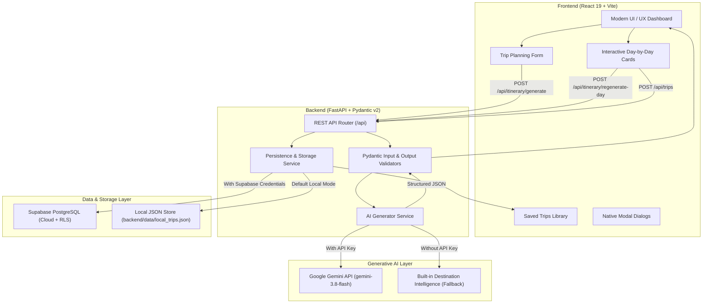

# WanderPlan AI: Personalized Travel Itinerary Planner

An AI-powered, production-grade travel planning web application that generates personalized, day-by-day travel itineraries customized to user budget, destination, travel dates, style, group size, interests, dietary preferences, and accessibility requirements.

Built with **React + Vite**, **FastAPI (Python)**, **Google Gemini Generative AI (`gemini-3.8-flash`)**, and **Supabase (PostgreSQL with Row Level Security)**.

---

## 1. System Architecture



---

## 2. Key Features

- **Personalized Itinerary Generation**: Day-by-day schedules with morning, afternoon, and evening attractions, realistic durations, categories, and estimated costs.
- **Budget Balancing**: Automatically calculates daily expenditures, overall total cost, and remaining budget with visual health meters ("Under budget", "Within budget", "Budget stretched").
- **Culinary Recommendations**: Tailored breakfast, lunch, and dinner suggestions accommodating vegetarian, vegan, halal, gluten-free, or custom dietary preferences.
- **Transit & Accessibility**: Practical navigation tips between activities with support for wheelchair access, low walking, and senior-friendly routing.
- **Interactive Customization**:
  - **Edit Activity Modal**: Modify titles, descriptions, locations, and costs with automatic recalculation of day subtotals and overall trip budget.
  - **Regenerate Single Day**: Request fresh activities or dining for a specific day with custom focus prompts (e.g. "more outdoor parks").
  - **Regenerate Entire Itinerary**: Fresh perspectives on the complete trip.
- **Trip Persistence**:
  - **Supabase Cloud Mode**: Complete PostgreSQL schema with Row Level Security (RLS) policies.
  - **Local Development Mode**: Automatic thread-safe JSON persistence when Supabase credentials are not configured.
- **Export & Share**:
  - Print / Export to PDF with optimized clean print styles.
  - One-click copy of trip summary to clipboard.
- **Dual-Engine Operation (Demo & Live AI)**:
  - If `GEMINI_API_KEY` is absent, runs in high-fidelity **Demo Mode** with curated intelligence across major world destinations and dynamic synthesis for any global city.
  - If `GEMINI_API_KEY` is present, calls the official `google-genai` SDK using `gemini-3.8-flash` with structured Pydantic JSON schemas.

---

## 3. Technology Stack

| Layer | Technologies Used |
|---|---|
| **Frontend** | React 19, Vite 8, JavaScript (ESM), Lucide Icons, Canvas Confetti |
| **Styling** | Modern CSS, Responsive Flex/Grid, Glassmorphism, CSS Variables, Print Media Styles |
| **Web Standards** | Native `<dialog>` element with `dialog:modal { overscroll-behavior: contain; }` and `::backdrop` styling |
| **Backend** | Python 3.14 / 3.11+, FastAPI, Uvicorn, Pydantic v2, Python-dotenv, Pytest |
| **AI Integration** | Official Google GenAI SDK (`google-genai`), `gemini-3.8-flash`, JSON Schema Enforcement |
| **Database** | Supabase (PostgreSQL 15+), Row Level Security (RLS), UUID keys, JSONB columns |
| **Testing** | Pytest, FastAPI TestClient, Vite Build verification |

---

## 4. Project Structure

```text
travel-itinerary-planner/
├── backend/
│   ├── app/
│   │   ├── __init__.py
│   │   ├── config.py             # Environment configuration & mode detection
│   │   ├── models.py             # Pydantic models & validation schemas
│   │   ├── routes/
│   │   │   ├── __init__.py
│   │   │   ├── health.py         # GET /health
│   │   │   ├── itinerary.py      # POST /api/itinerary/generate, /regenerate-day, /regenerate
│   │   │   └── trips.py          # GET, POST, PUT, DELETE /api/trips
│   │   └── services/
│   │       ├── __init__.py
│   │       ├── ai_generator.py   # Gemini API integration & Demo Mode engine
│   │       └── storage.py        # Supabase client & local storage fallback
│   ├── data/
│   │   ├── .gitkeep
│   │   └── local_trips.json      # Local persistence store
│   ├── tests/
│   │   ├── __init__.py
│   │   └── test_api.py           # Pytest test suite
│   ├── venv/                     # Python virtual environment
│   ├── main.py                   # FastAPI application entry point
│   ├── requirements.txt          # Python dependencies
│   ├── .env.example
│   └── .env
├── frontend/
│   ├── public/
│   ├── src/
│   │   ├── components/
│   │   │   ├── ConfigModal.jsx   # Credentials setup & Viva reference guide
│   │   │   ├── DayCard.jsx       # Individual day schedule & dining card
│   │   │   ├── EditActivityModal.jsx # Native dialog for editing activities
│   │   │   ├── Hero.jsx          # Landing hero with quick destination presets
│   │   │   ├── Navbar.jsx        # Navigation bar with live status chips
│   │   │   ├── SavedTrips.jsx    # Saved trips management view
│   │   │   ├── Toast.jsx         # Floating toast notifications
│   │   │   ├── TripForm.jsx      # Multi-field trip customization form
│   │   │   └── TripSummary.jsx   # Budget meter, duration, actions & tips
│   │   ├── services/
│   │   │   ├── api.js            # Frontend API client
│   │   │   └── supabaseClient.js # Supabase client & auth helpers
│   │   ├── App.jsx               # Main state orchestrator
│   │   ├── App.css
│   │   ├── index.css             # Design system & responsive styles
│   │   └── main.jsx              # React DOM entry
│   ├── index.html
│   ├── package.json
│   ├── vite.config.js            # Vite configuration with /api proxy
│   ├── .env.example
│   └── .env
├── supabase/
│   └── schema.sql                # Complete PostgreSQL schema with RLS policies
├── .env.example                  # Root environment template
├── .gitignore                    # Production Git ignore rules
└── README.md                     # Comprehensive documentation
```

---

## 5. Local Setup & Execution Instructions

### Prerequisites
- **Node.js**: v18+ (tested with Node v24)
- **Python**: v3.10+ (tested with Python 3.14)
- **Git**

### Step 1: Clone the Repository
```bash
git clone <repository-url>
cd travel-itinerary-planner
```

### Step 2: Backend Setup
```bash
cd backend

# Create virtual environment (if not already present)
python -m venv venv

# Activate virtual environment
# Windows:
.\venv\Scripts\activate
# Linux/macOS:
# source venv/bin/activate

# Install dependencies
pip install -r requirements.txt

# Start the FastAPI server
python main.py
```
*The backend starts at `http://127.0.0.1:8000`. You can inspect interactive Swagger documentation at `http://127.0.0.1:8000/docs`.*

### Step 3: Frontend Setup
Open a new terminal window:
```bash
cd frontend

# Install dependencies
npm install

# Start Vite development server
npm run dev
```
*The frontend starts at `http://localhost:5173`. Open this URL in your browser.*

---

## 6. Environment Variables Configuration

Create a `.env` file in `backend/` (or copy from `backend/.env.example`):

```ini
# Google Gemini API Key (Optional)
# Leave blank to run in Demo Mode.
# Get free key: https://aistudio.google.com/
GEMINI_API_KEY=your_gemini_api_key_here

# Model to use (Defaults to gemini-3.8-flash)
GEMINI_MODEL=gemini-3.8-flash

# Supabase Database (Optional)
# Leave blank to use local storage in backend/data/local_trips.json.
# Get credentials: https://supabase.com/
SUPABASE_URL=https://your-project.supabase.co
SUPABASE_KEY=your_supabase_anon_or_service_key

# Backend port
PORT=8000
```

Frontend `.env` in `frontend/` (or copy from `frontend/.env.example`):
```ini
# Leave empty in local dev to use Vite proxy
VITE_API_BASE_URL=

# Supabase client (Optional)
VITE_SUPABASE_URL=
VITE_SUPABASE_ANON_KEY=
```

---

## 7. Supabase Database Setup

1. Create a free project on [Supabase](https://supabase.com/).
2. Open the **SQL Editor** tab in your Supabase dashboard.
3. Open `supabase/schema.sql` from this repository and copy its entire contents.
4. Paste the SQL into the Supabase SQL editor and click **Run**.
5. The schema creates:
   - `profiles` table with automatic signup trigger.
   - `trips` table with budget, dates, travel style, and metadata constraints.
   - `itineraries` table storing day-by-day JSON structures and practical tips.
   - Row Level Security (RLS) enabled on all tables with user-isolation policies (`auth.uid() = user_id`).
6. Copy your **Project URL** and **API Key** from Project Settings → API, and add them to `backend/.env`.

---

## 8. API Endpoint Documentation

| Method | Endpoint | Description |
|---|---|---|
| `GET` | `/health` | Returns system operational status, AI engine mode, and storage mode. |
| `POST` | `/api/itinerary/generate` | Generates a complete itinerary from user preferences. |
| `POST` | `/api/itinerary/regenerate-day` | Regenerates activities & dining for an individual day. |
| `POST` | `/api/itinerary/regenerate` | Regenerates the entire itinerary with fresh variations. |
| `GET` | `/api/trips` | Retrieves all saved trips. |
| `GET` | `/api/trips/{trip_id}` | Retrieves a single saved trip by ID. |
| `POST` | `/api/trips` | Saves a new trip and its itinerary. |
| `PUT` | `/api/trips/{trip_id}` | Updates a saved trip (title, notes, or modified activities). |
| `DELETE` | `/api/trips/{trip_id}` | Deletes a saved trip. |

Interactive API documentation (Swagger UI) is available at: `http://127.0.0.1:8000/docs`

---

## 9. Testing & Reliability

The backend includes automated tests using `pytest` and `fastapi.testclient`.

To run tests:
```bash
cd backend
.\venv\Scripts\pytest tests -v
```

### Test Coverage
- `test_health_endpoint`: Verifies system status, AI engine info, and persistence status.
- `test_generate_itinerary_valid`: Tests itinerary generation, total day calculation, and schema validation.
- `test_generate_itinerary_validation_date_error`: Tests that invalid date ranges (e.g., end date before start date) return HTTP 422.
- `test_generate_itinerary_negative_budget`: Tests that negative budget inputs return HTTP 422.
- `test_regenerate_day`: Tests individual day regeneration with user focus notes.
- `test_trips_crud_lifecycle`: End-to-end integration test creating, reading, updating, and deleting a saved trip.

To verify frontend build:
```bash
cd frontend
npm run build
```

---

## 10. Deployment Guide

### Frontend Deployment (Vercel)
1. Push this repository to GitHub.
2. Sign in to [Vercel](https://vercel.com/) and click **Add New Project**.
3. Import the repository and select the **Root Directory** as `frontend`.
4. Framework Preset: **Vite**.
5. Add Environment Variable:
   - `VITE_API_BASE_URL`: Your deployed backend URL (e.g. `https://travel-planner-api.onrender.com`).
6. Click **Deploy**.

### Backend Deployment (Render)
1. Sign in to [Render](https://render.com/) and create a **New Web Service**.
2. Connect your GitHub repository.
3. Configure the service:
   - **Root Directory**: `backend`
   - **Environment**: `Python`
   - **Build Command**: `pip install -r requirements.txt`
   - **Start Command**: `uvicorn main:app --host 0.0.0.0 --port $PORT`
4. In **Environment Variables**, add:
   - `GEMINI_API_KEY`: Your Google AI Studio API key
   - `GEMINI_MODEL`: `gemini-3.8-flash`
   - `SUPABASE_URL`: Your Supabase URL
   - `SUPABASE_KEY`: Your Supabase Key
5. Click **Create Web Service**.

---

## 11. Viva / Technical Presentation Q&A

**Q1: How does Generative AI generate structured data instead of unstructured text?**  
*Answer:* We use the official `google-genai` SDK and configure `types.GenerateContentConfig` with `response_mime_type="application/json"` and `response_json_schema=GeneratedItinerary.model_json_schema()`. This forces the Gemini model to output valid JSON conforming strictly to our Pydantic schema, eliminating parsing failures.

**Q2: What happens if the Gemini API key is missing or encounters a rate limit?**  
*Answer:* The application implements graceful degradation. It detects the missing key at startup, transitions into a clearly labeled **Demo Mode**, and serves rich, realistic itineraries generated by our internal destination engine without crashing. It displays a disclaimer informing the user that demo mode is active.

**Q3: How is database security handled in Supabase?**  
*Answer:* We enabled **Row Level Security (RLS)** on all PostgreSQL tables. Policies enforce that users can only select, insert, update, or delete rows where `auth.uid() = user_id`.

**Q4: How does editing an activity update the budget?**  
*Answer:* When a user updates an activity in the Edit Activity Modal, the frontend recalculates the day's subtotal and the overall trip expenditure. It compares the new total with the user's allocated budget and updates the visual meter status in real time.

---

## 12. Limitations & Future Work

- **Live Flight & Hotel Booking**: Currently provides realistic budget estimates. Future work will integrate Amadeus or Skyscanner APIs for live flight fares.
- **Interactive Map Visualization**: Future iterations can integrate Leaflet or Mapbox to plot daily activity markers and transit polylines on an interactive map.
- **Offline PWA Support**: Adding service workers for complete offline itinerary browsing while travelling.
